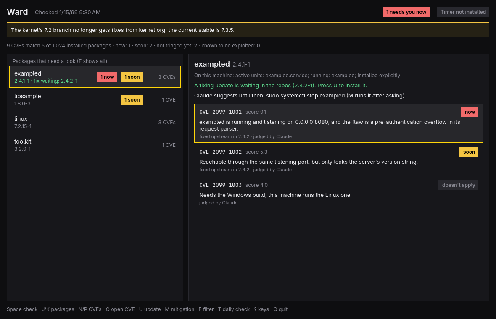

# Ward

*Idea: [nerdcules](https://github.com/nerdcules) · Written by: Claude, in [Claude Code](https://claude.com/claude-code)*



Ward says which published CVEs affect this machine, and which of them matter
here. It matches every installed pacman package, and the kernel, against
CVE.org's records, Arch's security tracker and CISA's list of exploited
vulnerabilities. It works out what the machine actually uses, and has Claude
judge what it can't settle itself. A daily check sends a desktop alert when
something needs you.

Ward never installs or changes anything on its own. When a fixed package is
waiting in the repos, or Claude suggests a mitigation, the window shows the
command and runs it in a terminal only after you confirm.

## Install

```bash
bin/install          # builds the Arch package and installs it with makepkg -fsi
ward schedule on     # the daily check (or press T in the window)
```

It needs Qt 6 (base, declarative, svg, wayland), libarchive, pacman-contrib
(`checkupdates`) and iproute2 (`ss`). Triage needs Claude Code (`claude` on the
PATH); without it, Ward still matches and reports, and says triage failed.

### Updating

Ward is one of the apps `nerdcules-update` looks after
([nerdcules](https://github.com/nerdcules/nerdcules), README section "Updates"):

```bash
nerdcules-update apply ward       # the newest release on Ward's channel
nerdcules-update rollback ward    # back to the version before
```

Releases are git tags `vMAJOR.MINOR.PATCH`, pre-releases `vMAJOR.MINOR.PATCH-rc.N`.
The first is a pre-release, `v0.1.0-rc.1`, which the default stable channel
doesn't offer; to take it:

```bash
nerdcules-update channel ward prerelease
nerdcules-update apply ward
```

## Keys

| Key | Does |
| --- | --- |
| Space, R | Check now: update the CVE list, match, triage what is new |
| J / K, ↓ / ↑ | Move between packages |
| N / P | Move between the selected package's CVEs |
| O | Open the selected CVE on cve.org |
| U | Install the waiting update in a terminal (asks first) |
| M | Run Claude's suggested mitigation in a terminal (asks first) |
| F | Show every package with a match, or only those that need a look |
| T | Turn the daily check on or off |
| ? | Show every shortcut |
| Ctrl + I | About Ward |
| Q | Quit |

The window doesn't check by itself when it opens, because a check can call
Claude; press Space.

## Command line

```
ward check [--json] [--offline] [--no-triage] [--notify] [--list] [--all]
ward update                     only bring the CVE list up to date
ward status [--json] [--list] [--all]
ward show <CVE-ID>              one record, every product and range it names
ward fix <package>              what would fix it (printed, never run)
ward schedule on|off|status     the daily check, a systemd user timer
ward skill install              the agent skill, into ~/.claude/skills/ward
```

`ward check` prints one line per package: how many CVEs match, how many
triage rated "now" or "soon", how many aren't triaged yet, and the fixed
version upstream or waiting in the repos.

## Where the CVEs come from

- **CVE.org's records** (the CVEProject/cvelistV5 releases on GitHub). The
  first check downloads the full list once. On 20 Nov 2026 that was
  669,188,631 bytes and 429,245 records; reading it took 68 s here. Ward keeps
  a SQLite copy in `~/.cache/ward` (441,798,656 bytes that day) and deletes the
  download. After that, each check fetches one "end of day" change file for
  each whole day it missed, plus today's newest hourly one. A check without
  triage (`--no-triage`, network on) took 7.5 s here.
- **Arch's security tracker** (`security.archlinux.org`). It names Arch
  packages and the exact package version that fixed them, so where it covers a
  CVE for a package, its answer wins. On 20 Nov 2026 only 3 of its 2,444
  advisory groups had a 2026 CVE as their newest, which is why it can't be the
  only source.
- **CISA's Known Exploited Vulnerabilities**, to flag CVEs attacked in the wild.
- **kernel.org's list of maintained branches**, to say when the running
  kernel's branch no longer gets fixes.

NVD isn't used. In the 120 days to 20 Nov 2026 it published 60,077 CVEs, and
41,602 of those had no product data (CPE) to match against. All 100 CVE.org
records sampled from that gap named products and versions.

## How a package is matched

CVE.org records name products, not Arch packages. A package is looked up by
its own name (`lib32-x` as `x`, `python-x` also as `x` among PyPI products),
and the kernel packages as vendor Linux's "Linux". Version ranges are read as
the CVE record format defines them, and compared the way upstream numbers
versions: OpenSSH's `10.6p1` comes after `10.6`, and glibc's `2.44+r50+g…`
snapshot counts as 2.44. `src/names.json` pins the vendors for names that
other products share (python, ruby, brotli, snappy, graphene), and
`~/.config/ward/names.json` adds your own. A package from outside the repos
(the AUR, or built here) counts a record only when the record's vendor appears
in the package's URL.

Matches are by version, so they can't see a fix Arch carries as a patch
without changing the version. Triage is told so.

## What the machine uses, and triage

For each package with matches, Ward gathers what it can see without root:
its active systemd units, the processes started from its files, the
processes (yours only) that have its libraries loaded, the sockets those
listen on, and whether a fixing update is waiting (`checkupdates`, which uses
a temporary copy of the package databases). For the kernel it reads which
source files each CVE names and finds them in this kernel: loaded,
built in, core, in a module that isn't loaded, or in another
architecture's code.

Ward settles two kinds of kernel finding itself: code for another
architecture doesn't apply, and code in a module that isn't loaded is
"unclear, later", since some modules load on demand. The rest goes to
Claude, up to 25 CVEs of one package at a time and at most 10 times a check
(`WARD_TRIAGE_CALLS` changes that), most urgent first. Claude Code runs as
`claude -p` with no tools, no MCP servers, no settings or hooks, and nothing
saved, on your Claude account, using `claude-sonnet-5-5` unless
`WARD_TRIAGE_MODEL` says otherwise. For each CVE it answers whether it applies
(yes, no, unclear), how soon it matters (now, soon, later), and why in a
sentence. It may suggest a mitigation. Answers are kept in
`~/.local/state/ward/triage.json` per CVE, package and version, so each is
asked once; `lib32-x` reuses `x`'s answer at the same upstream version.

**What leaves the machine for triage:** the package's name and version, each
CVE's id, score, dates, title and description, the evidence above (unit and
process names, listening addresses), and the fact that this is an Arch-based
Omarchy laptop with glibc, systemd and PAM.

Measured on this machine on 20 Nov 2026 (1,212 packages): 941 CVEs matched
90 packages before the fixes that run prompted, 908 matched 80 after. The
first triaged check made 10 calls in 73 s, which Claude Code reported as
$0.24. Claude judged 75 findings (14 don't apply, 61 unclear, all "later")
and Ward settled 233 kernel ones; 604 were left for later checks. Claude's
answers caught a CVE for a different product called gpm, a Windows-only
yt-dlp flaw, and an exploited OpenSSH flaw that needs musl without PAM.

## The daily check

`ward.timer` is a systemd user timer the package installs; press T or run
`ward schedule on`. It runs `ward check --notify` once a day. An alert goes
out for findings triaged as "now", exploited ones triage hasn't ruled out,
and a kernel branch kernel.org no longer maintains, each once (remembered in
`~/.local/state/ward/notified.json`).

## Files

| Path | Holds |
| --- | --- |
| `~/.cache/ward/cve.sqlite` | the CVE list; delete it to download again |
| `~/.cache/ward/*.json` | the tracker, KEV and kernel.org feeds, last copy |
| `~/.local/state/ward/findings.json` | the last check's results |
| `~/.local/state/ward/triage.json` | Claude's answers |
| `~/.config/ward/names.json` | your own name and vendor rules |

## Tests

`bin/test` builds and runs the Qt Test suite offscreen: on 20 Nov 2026, 29
passed, 0 failed, 0 skipped. Records and tracker groups in `tests/fixtures`
are real ones fetched that day; `claude-stub.sh` stands in for Claude Code.
Version order is checked against pacman's own `vercmp` on 27 pairs.

## Licence

MIT. The theme and translator sources follow Omacut and Monologue (see
`LICENSE`).
